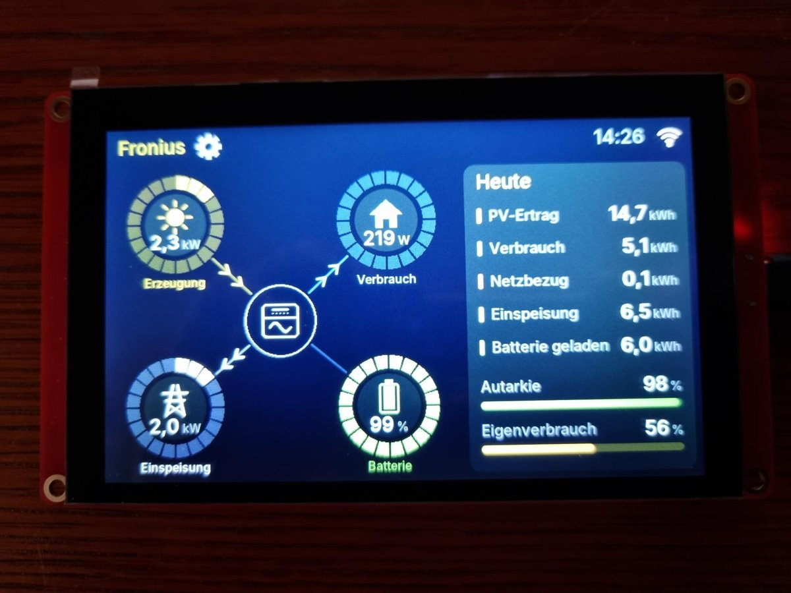
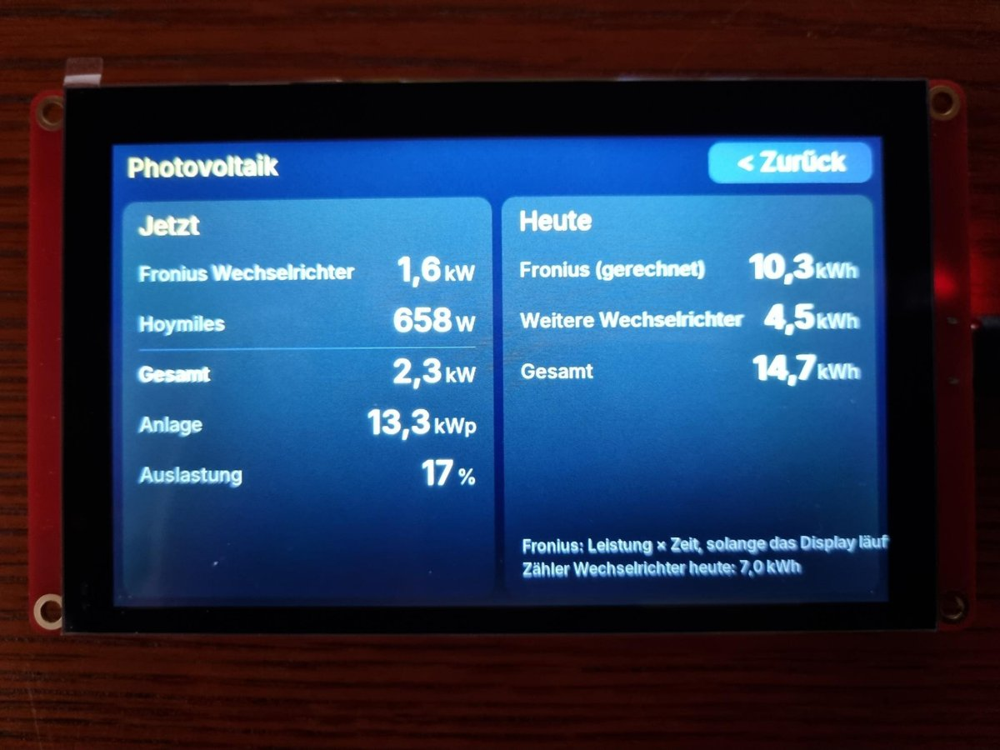
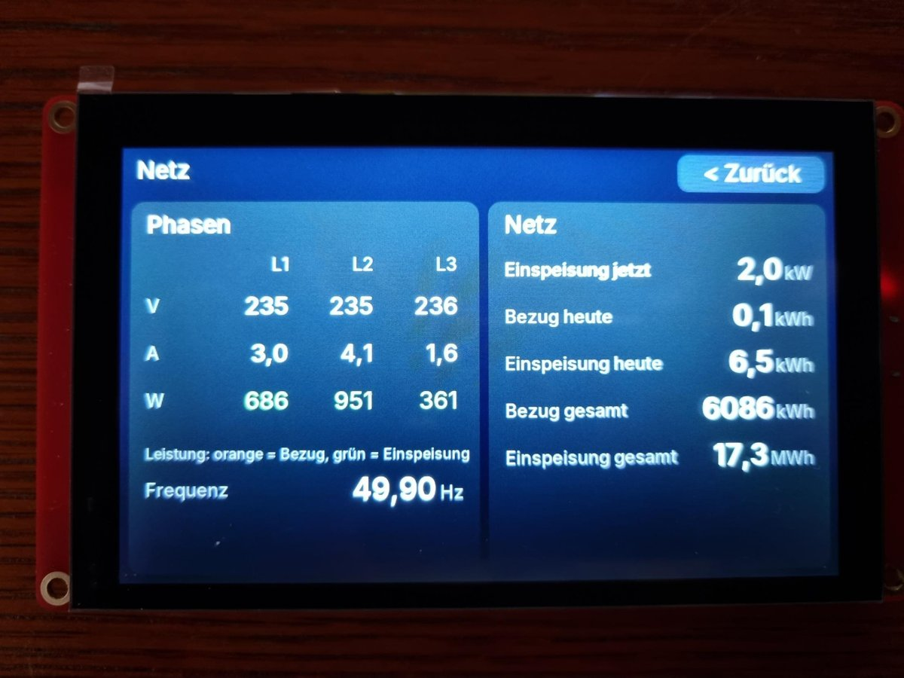
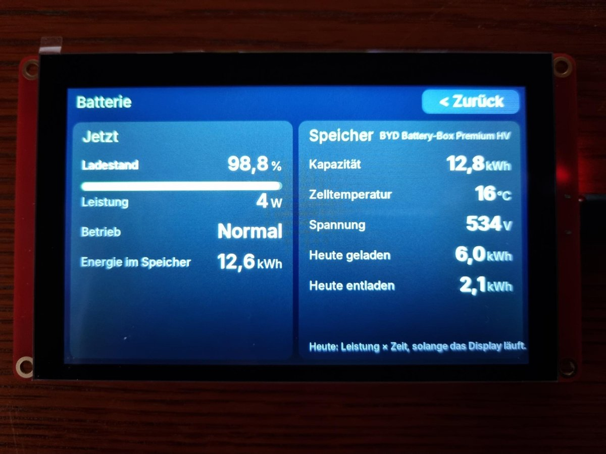
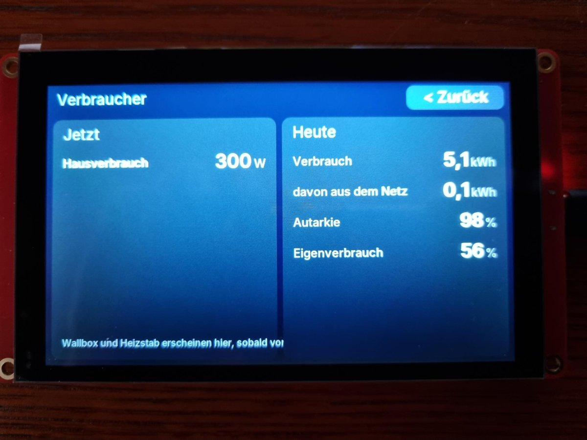
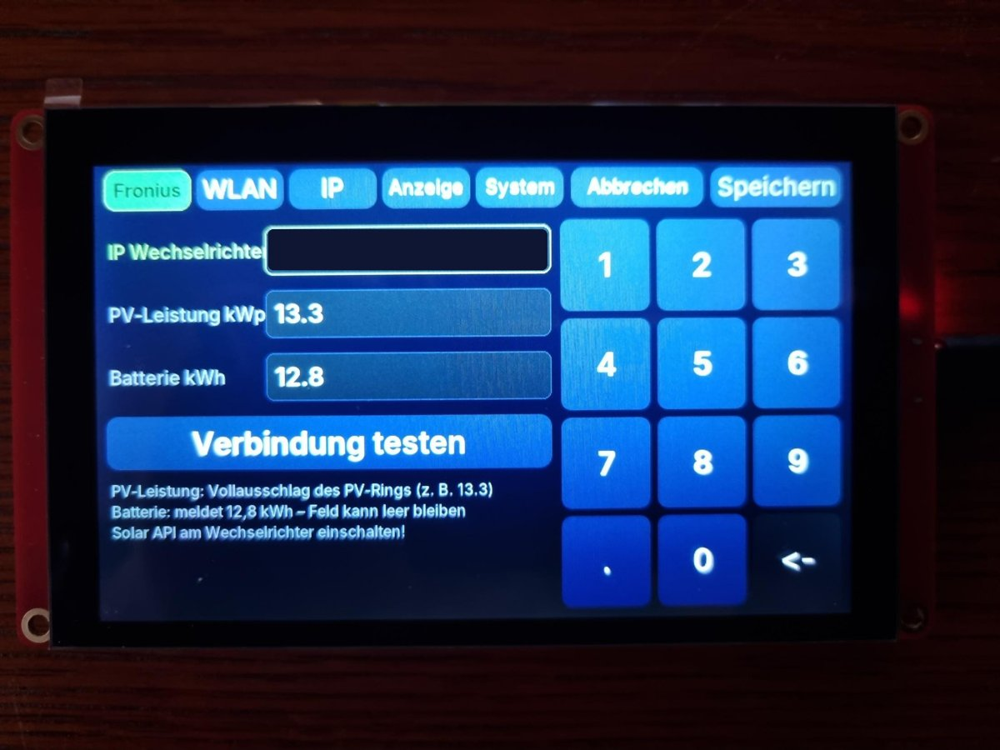
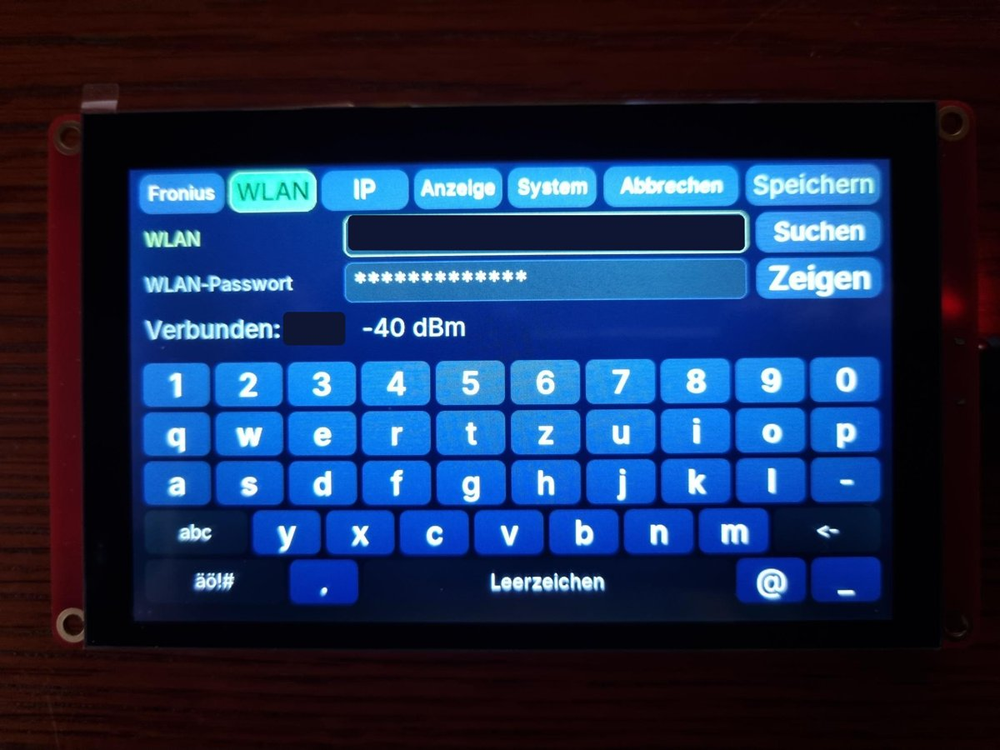
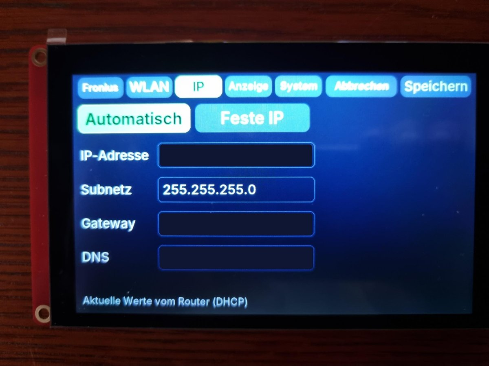
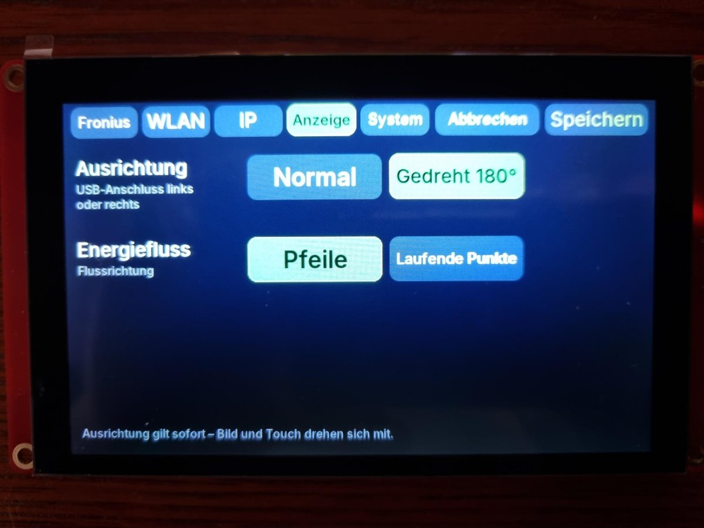
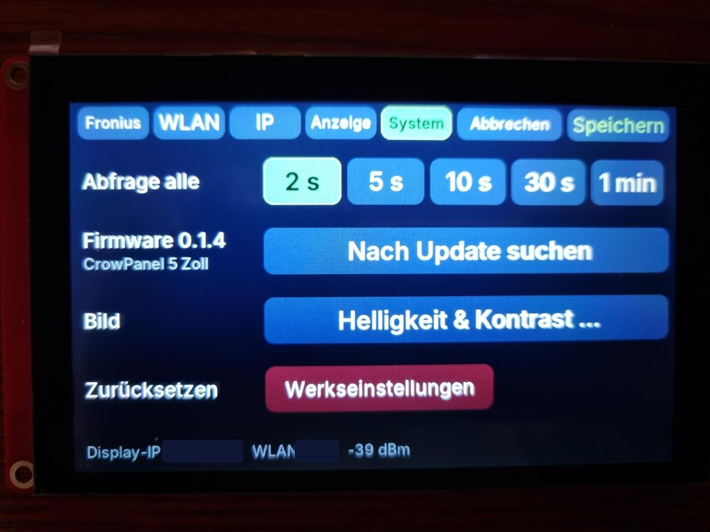

# Fronius-Display

Eigenständiges Touch-Display für **Fronius-Wechselrichter** (getestet: Symo GEN24) –
auf einem günstigen ESP32-S3-Display, ohne ioBroker, Home Assistant oder Server.
Das Display holt sich die Werte per WLAN direkt vom Wechselrichter (Fronius Solar API).

> **Kein offizielles Produkt von Fronius.** Bei Fragen zum Display bitte hier im
> Repository ein Issue anlegen, nicht bei Fronius. Nutzung auf eigene Gefahr.

> **Status: 0.1.x – erste Testversionen.** Läuft auf dem 5" an einem Symo GEN24 mit
> BYD-Batterie und zusätzlichem Hoymiles-Wechselrichter.

## Installation

1. Display per USB-C anschließen.
2. **[Web-Installer öffnen](https://alpi-brv.github.io/fronius-display/)** in Chrome oder Edge.
3. Den Knopf für **deine Größe** klicken (5" oder 7"), Anschluss wählen – fertig.

Danach öffnet das Display die Einstellungen: WLAN wählen, im Reiter **Fronius** die IP
des Wechselrichters eintragen, *Speichern*.

## Bilder



*Startseite auf dem 5" – Energiefluss und Tageswerte*

| Photovoltaik | Netz mit Phasen |
|---|---|
|  |  |

| Batterie | Verbraucher |
|---|---|
|  |  |

<details>
<summary>Einstellungen (Bilder)</summary>

| Fronius | WLAN |
|---|---|
|  |  |

| IP | Anzeige |
|---|---|
|  |  |

| System | |
|---|---|
|  | |

</details>

## Funktionen

- **Energiefluss** wie in Solar.web: PV, Verbraucher, Netz und Batterie als Segmentringe
  um den Wechselrichter; Pfeile (oder auf Wunsch laufende Punkte) zeigen die Flussrichtung
- **Antippen öffnet Details:**
  - PV – Aufteilung je Wechselrichter (z. B. GEN24 + zusätzlicher Wechselrichter
    über Fronius Smart Meter), später Strings über Modbus
  - Netz – Phasen L1–L3 mit Spannung, Strom, Leistung, Frequenz
  - Batterie – Ladestand, Lade-/Entladeleistung, „reicht noch ca. …“ / „voll in ca. …“
  - Verbraucher – Haus, später Wallbox (Wattpilot) und Heizstab (Ohmpilot) getrennt
- **Tageswerte:** PV-Ertrag, Verbrauch, Netzbezug, Einspeisung, Batterie geladen,
  Autarkie, Eigenverbrauch – aus den Zählerständen selbst berechnet
  (der GEN24 liefert keine Tageswerte)
- **Ausrichtung wählbar:** USB-Anschluss links oder rechts (Drehung um 180°) –
  wirkt sofort, Bild und Touch drehen sich mit
- **Einrichtung komplett am Display:** WLAN, feste IP oder DHCP, IP des Wechselrichters,
  PV-Leistung (kWp, Vollausschlag des PV-Rings), Batteriekapazität (für die Restzeit)
- **Updates über WLAN** und Installation im Browser – wie beim
  [Violet Pool-Display](https://github.com/AlPi-BRV/violet-display)
- Dimmt nach 5 Minuten ohne Berührung; Detail- und Einstellungsseiten schließen sich nach 1 Minute

### Geplant

- Statistik für Tag, Monat, Jahr; optional mit **SD-Karte** auch Tagesverläufe
- Strings (MPPT) über Modbus TCP
- Wallbox (Wattpilot) mit eigener Abfrage

## Wie die Tageswerte entstehen

Der GEN24 liefert keine Tageswerte (`E_Day` ist leer). Das Display rechnet selbst:

| Wert | Quelle | Genauigkeit |
|---|---|---|
| Netzbezug, Einspeisung | Zählerstände des Smart Meters am Netzanschluss | genau |
| Weitere Wechselrichter (z. B. Hoymiles) | Zählerstand ihres Smart Meters | genau |
| Verbrauch, Autarkie | Zähler: Wechselrichter + weitere WR + Bezug − Einspeisung | genau |
| PV des Fronius, Batterie geladen/entladen | Leistung × Zeit, solange das Display läuft | Näherung |

Die Stände des Tagesbeginns werden alle 5 Minuten im Flash gesichert und überstehen
Stromausfall, Neustart und Updates. Die zählerbasierten Werte stimmen auch, wenn das
Display zwischendurch aus war; bei den Näherungswerten fehlt die Zeit ohne Strom.
Startet das Display mitten am Tag zum ersten Mal, zeigt „Heute“ die Werte *seit* dieser Uhrzeit.

## Voraussetzungen am Wechselrichter

Im Webinterface des Wechselrichters muss die **Solar API** eingeschaltet sein
(Kommunikation → Solar API). Test im Browser:

```
http://<IP-des-Wechselrichters>/solar_api/v1/GetPowerFlowRealtimeData.fcgi
```

Erscheint dort JSON, ist alles bereit.

## Bedienung

- **Kreis antippen** → Details (PV, Verbraucher, Netz mit Phasen L1–L3, Batterie mit Restzeit)
- **Tageswerte antippen** → Details Verbraucher
- **Zahnrad** oder Kopfzeile 2 Sekunden halten → Einstellungen
- Auf einer Detailseite irgendwohin tippen → zurück

| Reiter | Inhalt |
|---|---|
| Fronius | IP des Wechselrichters, PV-Leistung (kWp), Batterie (kWh), *Verbindung testen* |
| WLAN | Netz suchen und wählen, WLAN-Passwort |
| IP | Automatisch (DHCP) oder feste IP |
| Anzeige | Ausrichtung (normal / 180° gedreht), Flussrichtung als Pfeile oder laufende Punkte |
| System | Abfrageintervall (2 s bis 1 min), Update, Helligkeit & Kontrast, Werkseinstellungen |

## Hardware

| | |
|---|---|
| Display | **Elecrow CrowPanel ESP32 5.0"**, SKU **DIS07050H**, Board-Revision **V3.0**<br>oder **Elecrow CrowPanel ESP32 7.0"**, SKU **DIS08070H**, Board-Revision **V3.0** |
| Chip | ESP32-S3-WROOM-1-N4R8 (4 MB Flash, 8 MB PSRAM) |
| Auflösung | 800 × 480, kapazitiver Touch |

> **Kaufempfehlung: das 5".** Das 7" (DIS08070H) läuft zwar mit derselben Firmware, sein Panel
> ist im Vergleich aber deutlich schwächer: Das Bild wirkt flau und dunkler, und der Blickwinkel
> ist eng – schon leicht von der Seite oder von oben verblassen die Farben. Die Einstellung
> *Kontrast* mildert das etwas, behebt es aber nicht. Wer das Display an der Wand oder schräg im
> Blick hat, ist mit dem 5" besser bedient.

Beide Größen brauchen **jeweils eigene Firmware** – jede Datei trägt die Größe im Namen
(`fronius-display-5zoll-…` / `fronius-display-7zoll-…`).

### Anderes Display?

Du hast ein anderes ESP32-Display – eine andere CrowPanel-Größe, die „Advance“-Reihe,
eine ältere Board-Revision oder ein Display eines anderen Herstellers – und möchtest die
Firmware darauf nutzen? Dann leg bitte ein **[Issue](https://github.com/AlPi-BRV/fronius-display/issues/new?template=anderes-display.yml)**
an und häng ein **Foto der Rückseite der Platine** an. Gut lesbar sollten sein:

- Aufdruck mit **Modell / SKU** und **Board-Revision** (z. B. „V3.0“)
- der **Chip** (z. B. „ESP32-S3-WROOM-1-N4R8“)
- die **Steckverbinder** und **Taster** (USB, BOOT, RESET, SD-Karte)

Dazu der **Link zum Produkt** (Shop oder Hersteller-Wiki). Damit lässt sich meist abschätzen,
ob das Display passt und was angepasst werden müsste.

## Selbst bauen (PlatformIO)

Wie beim Pool-Display: Ordner in VS Code mit PlatformIO öffnen, unten die Umgebung
**`env:crowpanel5`** oder **`env:crowpanel7`** wählen, *Upload*. Eigene Startwerte
(WLAN, IP des Wechselrichters) in `src/config_local.h` – wird von Git ignoriert:

```cpp
#define WIFI_SSID    "MeinWLAN"
#define WIFI_PASS    "geheim"
#define FRONIUS_HOST "192.168.1.60"
```

## Lizenz

MIT – siehe [LICENSE](LICENSE).
Verwendete Bibliotheken: [LovyanGFX](https://github.com/lovyan03/LovyanGFX),
[ArduinoJson](https://github.com/bblanchon/ArduinoJson).
Schrift: [Inter](https://rsms.me/inter/) (SIL Open Font License).
